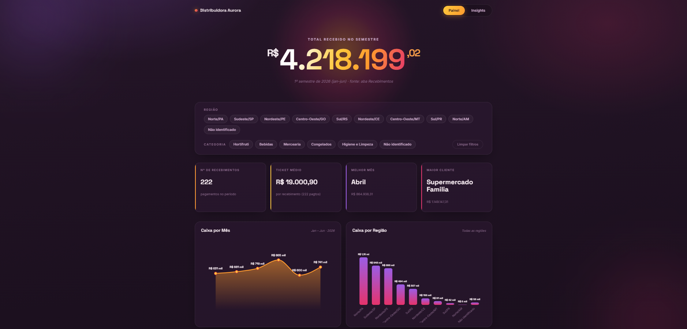

# Aurora Pagamentos — Dados e Dashboard

Projeto de portfólio simulando a rotina de conciliação financeira e análise de recebimentos de uma distribuidora fictícia (Distribuidora Aurora), cobrindo o primeiro semestre de 2026.

**Painel ao vivo:** https://danielterra13-lang.github.io/aurora-pagamentos-dados/

## O problema

A Aurora recebe pagamentos de mais de 200 clientes por diversos meios (Pix, boleto, transferência), e cada pagamento chega como um comprovante solto (PDF, foto ou print). Antes de qualquer análise, era preciso transformar essa pilha de comprovantes em dados estruturados e confiáveis.

## O que foi feito

1. **Conciliação** — leitura de cada um dos comprovantes na pasta `Comprovantes/` e lançamento de Data, Cliente, Valor e Forma de Pagamento na aba "Recebimentos" da planilha, com checagem de arquivos ilegíveis e duplicados.
2. **Dashboard no Excel** (`Controle_Recebimentos.xlsx`, aba "Dashboard") — KPIs do semestre (total recebido, nº de recebimentos, ticket médio, melhor mês, maior cliente) e 4 gráficos (caixa por mês, por região, por categoria e ranking de clientes), com tabelas de apoio fora da área de impressão e pagadores sem cadastro agrupados como "Não identificado".
3. **Painel interativo** (`index.html`) — versão standalone em HTML/D3.js do mesmo dashboard, com duas abas (Painel e Insights), filtros cruzados por Região e Categoria, tooltips com detalhe por mês/cliente e leitura executiva do semestre em linguagem de diretoria.

## Como abrir

- **Painel online:** https://danielterra13-lang.github.io/aurora-pagamentos-dados/
- `Controle_Recebimentos.xlsx` — abrir no Excel (ou LibreOffice Calc), aba "Dashboard".
- `index.html` — o mesmo painel, renomeado para ser a página inicial do GitHub Pages; também pode ser baixado e aberto direto no navegador.

## Stack

Python (openpyxl) para construção do dashboard no Excel; HTML, CSS e D3.js para o painel interativo. Dados 100% sintéticos, gerados para fins de portfólio.
